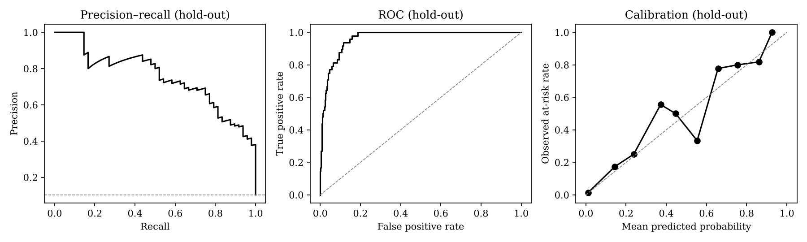

# Model evaluation — logistic-regression-20261106-4ed8f1

> **Trained and evaluated on SYNTHETIC data. These metrics test the pipeline only and are not evidence about real learners.**

## Set-up

* Label: Assessment accuracy in the 28 days after the cut-off is below 50% (rows with fewer than 3 marked assessment answers are unlabelled and excluded).
* Training cohort H1: 467 rows from 289 learners (prevalence 6.2%).
* Temporal hold-out cohort H2: 465 rows from 269 different learners (prevalence 10.3%).
* Features (fv-1.1): acc_all, acc_recent, acc_trend, acc_assessment, chapter_min_acc, chapters_below_50, diag_error_rate, repeat_error_rate, completion_rate, active_days_28, days_since_active, rel_time_median, hint_rate, n_responses. Page interruptions are not used.
* Selection rule: most interpretable model within 0.02 PR-AUC of the best (grouped 5-fold CV on the training cohort). Chosen: **Logistic regression**.
* Thresholds: moderate ≥ 0.1022, high ≥ 0.1792 — moderate = highest threshold with recall >= 80% (out-of-fold, training cohort); precision 70% not reachable; high = F1-maximising threshold above moderate.
* Data hash 4ed8f13812f4c637, seed 2026, scikit-learn 1.9.1, Python 3.13.18, trained 2026-11-06T03:55:37Z.

## Model comparison

| Model | CV PR-AUC | CV ROC-AUC | CV Brier | Hold-out PR-AUC | Hold-out ROC-AUC | Hold-out recall | Hold-out precision | Hold-out Brier | Hold-out ECE |
|---|---|---|---|---|---|---|---|---|---|
| Logistic regression (chosen) | 0.447 | 0.943 | 0.044 | 0.755 | 0.964 | 0.90 | 0.48 | 0.045 | 0.016 |
| Decision tree | 0.347 | 0.883 | 0.041 | 0.547 | 0.916 | 0.88 | 0.49 | 0.055 | 0.018 |
| Random forest | 0.433 | 0.937 | 0.042 | 0.716 | 0.957 | 0.83 | 0.53 | 0.050 | 0.030 |
| Gradient boosting | 0.443 | 0.931 | 0.053 | 0.577 | 0.942 | 0.85 | 0.54 | 0.067 | 0.059 |
| Support vector machine (RBF) | 0.322 | 0.823 | 0.053 | 0.642 | 0.917 | 0.92 | 0.27 | 0.063 | 0.050 |
| XGBoost | 0.430 | 0.937 | 0.049 | 0.660 | 0.945 | 0.81 | 0.52 | 0.058 | 0.045 |

Recall and precision are at each model's own 'moderate' threshold chosen on its out-of-fold training predictions.

## Chosen model on the hold-out cohort

PR-AUC 0.755 (no-skill baseline = prevalence 0.103), ROC-AUC 0.964, Brier 0.045, ECE 0.016.

| Threshold | Value | Accuracy | Precision | Recall | F1 | TP | FP | FN | TN |
|---|---|---|---|---|---|---|---|---|---|
| Moderate or high (flag) | 0.102 | 0.890 | 0.483 | 0.896 | 0.628 | 43 | 46 | 5 | 371 |
| High only | 0.179 | 0.918 | 0.574 | 0.812 | 0.672 | 39 | 29 | 9 | 388 |

## False positives and false negatives

At the flag threshold the model raised 46 false alarms (learners who went on to score at least 50 %) and missed 5 learners who did fall below 50 % (43 were caught). Missed learners compared with caught ones (mean feature values):

| Feature | Missed (FN) | Caught (TP) |
|---|---|---|
| acc_all | 0.548 | 0.293 |
| acc_assessment | 0.526 | 0.310 |
| n_responses | 53.800 | 46.326 |
| active_days_28 | 4.200 | 4.744 |
| diag_error_rate | 0.642 | 0.673 |

A false positive costs a teacher conversation; a false negative means a learner who needed help was not flagged. For an early-warning tool the moderate threshold is set for recall, and teachers are told that flags are prompts, not judgements.

## Calibration (hold-out)

| Predicted bin | n | Mean predicted | Observed rate |
|---|---|---|---|
| 0.0-0.1 | 376 | 0.011 | 0.013 |
| 0.1-0.2 | 23 | 0.144 | 0.174 |
| 0.2-0.3 | 12 | 0.238 | 0.250 |
| 0.3-0.4 | 9 | 0.372 | 0.556 |
| 0.4-0.5 | 10 | 0.446 | 0.500 |
| 0.5-0.6 | 6 | 0.554 | 0.333 |
| 0.6-0.7 | 9 | 0.658 | 0.778 |
| 0.7-0.8 | 5 | 0.755 | 0.800 |
| 0.8-0.9 | 11 | 0.861 | 0.818 |
| 0.9-1.0 | 4 | 0.926 | 1.000 |

## Subgroups (hold-out)

| Group | n | Prevalence | PR-AUC | Recall | Precision |
|---|---|---|---|---|---|
| school_id=SCH-HL | 118 | 0.119 | 0.770 | 0.86 | 0.60 |
| school_id=SCH-LK | 116 | 0.086 | 0.646 | 0.70 | 0.30 |
| school_id=SCH-NB | 122 | 0.115 | 0.843 | 1.00 | 0.61 |
| school_id=SCH-RV | 109 | 0.092 | 0.657 | 1.00 | 0.43 |
| grade=9 | 94 | 0.106 | 0.519 | 0.80 | 0.44 |
| grade=10 | 230 | 0.096 | 0.800 | 0.95 | 0.50 |
| grade=11 | 141 | 0.113 | 0.819 | 0.88 | 0.48 |

## Ablation: do behaviour and engagement features add anything?

Outcome features only: PR-AUC 0.746. Full feature set: PR-AUC 0.755. Difference +0.009 (95 % learner-level bootstrap CI -0.037 to +0.052, 1000 resamples). The interval includes zero, so no improvement is demonstrated.

## Cross-platform comparison (WOW Sir, DBWOW)

All hold-out rows: CS Lifeline features PR-AUC 0.755; with verified WOW Sir and DBWOW features 0.752 (difference -0.002, 95 % CI -0.065 to +0.061).
* Learners with a verified WOW Sir link (179 hold-out rows): WOW Sir features alone PR-AUC 0.583; CS Lifeline alone 0.579; combined 0.646 (combined − CS Lifeline +0.067, CI -0.047 to +0.174).
* Learners with a verified DBWOW link (124 hold-out rows): DBWOW features alone PR-AUC 0.417; CS Lifeline alone 0.823; combined 0.856 (combined − CS Lifeline +0.033, CI -0.069 to +0.170).

Combined data is reported as better only when the confidence interval excludes zero.

## Most influential features

| Feature | Weight |
|---|---|
| acc_all | -1.790 |
| hint_rate | +0.409 |
| chapters_below_50 | +0.345 |
| diag_error_rate | +0.213 |
| days_since_active | -0.209 |
| active_days_28 | -0.190 |
| acc_assessment | +0.169 |
| acc_recent | -0.167 |
| completion_rate | -0.141 |
| n_responses | +0.106 |

Weights are standardised logistic coefficients (log-odds per standard deviation) for logistic regression, or impurity importance for tree ensembles.
